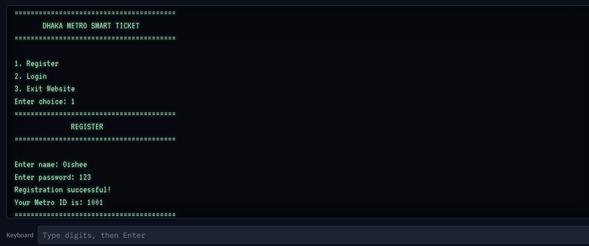
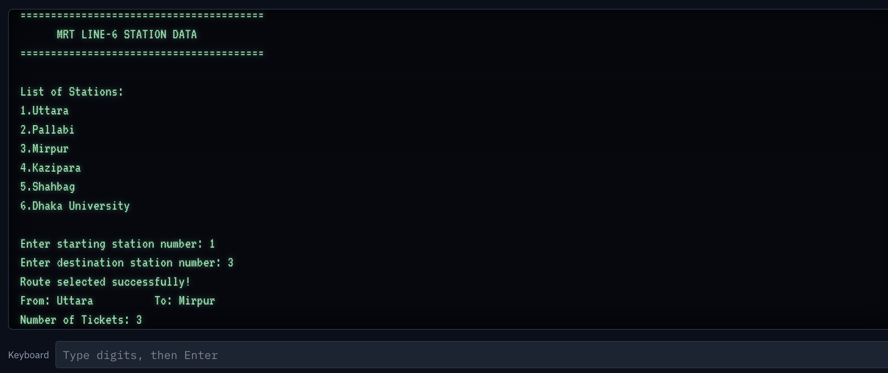
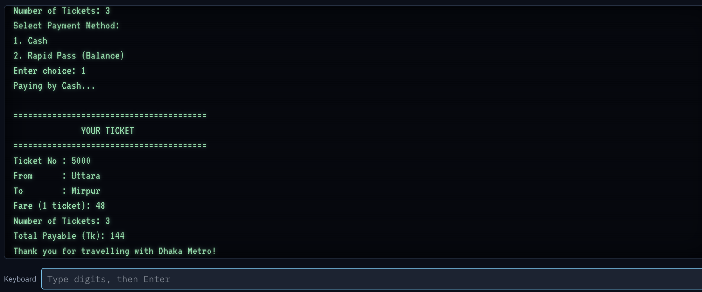

# Dhaka Metro Smart Ticket System

An 8086 Assembly Language project that simulates a smart ticketing system for Dhaka Metro Rail. The system allows users to register, log in, select routes, calculate fares, purchase tickets, and manage payments through cash or a virtual Rapid Pass balance.

## Project Overview

The Dhaka Metro Smart Ticket System is a menu-driven ticketing application developed using 8086 Assembly Language. It simulates the basic operations of a metro ticketing system, from user registration and route selection to fare calculation, ticket generation, and payment.

The project also incorporates additional features such as travel history, frequently visited station tracking, revenue reporting, and peak-hour fare calculation.

## Features

### 1. User Registration
- Allows new users to register with their name and password.
- Automatically assigns a unique Metro ID to each registered user.
- Supports up to 10 registered users.

### 2. User Login
- Allows registered users to log in using their Metro ID and password.
- Validates the entered credentials before providing access to the user menu.

### 3. Station List and Route Selection
- Displays six selected MRT Line-6 stations:
  - Uttara
  - Pallabi
  - Mirpur
  - Kazipara
  - Shahbag
  - Dhaka University
- Allows users to select their starting and destination stations.
- Validates station selections before proceeding with ticket booking.

### 4. Fare Calculation
- Calculates the journey distance using the stored station-distance values.
- Applies a base fare and a per-kilometre charge.
- Calculates the fare based on the selected route.

**Fare calculation formula:**

`Regular Fare = Base Fare + (Distance × Fare per KM)`

The implemented values are:
- Base fare: Tk 20
- Fare per kilometre: Tk 2

### 5. Ticket Generation
- Generates a unique ticket number, beginning from 5000.
- Displays the journey details, including:
  - Ticket number
  - Starting station
  - Destination station
  - Fare per ticket
  - Number of tickets
  - Total payable amount
  - Peak-hour surcharge, when applicable

### 6. Payment Methods

The system provides two payment options:

**Cash Payment**
- Allows users to pay directly using cash.
- Generates the ticket after selecting the cash payment option.

**Rapid Pass Payment**
- Allows users to load money into a virtual Rapid Pass balance.
- Deducts the payable amount from the available balance after a successful transaction.
- Blocks transactions when the balance is insufficient.
- Displays the remaining balance after payment.

### 7. Travel History
- Stores previous ticket information.
- Allows users to view their past journeys.
- Displays ticket numbers, routes, ticket quantities, and fares.
- Tracks station visits to identify the most frequently visited station or stations.

### 8. Revenue Report
- Displays the total number of tickets sold.
- Calculates and displays the total revenue generated through successful ticket purchases.

### 9. Peak-Hour Fare
- Uses the system clock to identify peak hours.
- Retrieves system time through DOS interrupt `INT 21H`, function `AH = 2CH`.
- Applies an additional Tk 15 surcharge during the implemented peak-hour periods:
  - Morning: 8:00 AM – 9:59 AM
  - Evening: 5:00 PM – 7:59 PM

## Technologies Used

- **Programming Language:** 8086 Assembly Language
- **Development/Execution Environment:** EMU8086
- **Interrupts:** DOS Interrupt `INT 21H`
- **Data Handling:** Assembly arrays and memory variables

## How the System Works

The application follows a menu-driven workflow:

1. **Main Menu:** Users can register, log in, or exit the application.
2. **Registration:** New users provide their name and password and receive a Metro ID.
3. **Login:** Registered users enter their Metro ID and password.
4. **User Menu:** After successful login, users can book tickets, view the revenue report, check travel history, access their Rapid Pass balance, or log out.
5. **Ticket Booking:** Users select their starting and destination stations.
6. **Fare Calculation:** The system calculates the journey distance and fare, including any applicable peak-hour surcharge.
7. **Payment:** Users choose between cash and Rapid Pass payment.
8. **Ticket Generation:** After successful payment, the system generates and displays the ticket.
9. **History and Reports:** Ticket information, station visits, ticket counts, and revenue are updated for viewing.

## Screenshots

The following screenshots demonstrate the program interface and its main operations.

### Main Menu

### Ticket Generation

### Payment Interface

## How to Run the Project

1. Install and open **EMU8086**.
2. Open the `dhaka_metro.asm` source file.
3. Compile the Assembly program.
4. Run the program using the emulator.
5. Follow the on-screen menu instructions to register, log in, select a route, and purchase tickets.

## Implementation Notes

- The application is a console-based simulation of a metro ticketing system.
- User information, ticket history, and transaction data are maintained in memory during program execution.
- The current implementation supports a maximum of 10 registered users and 20 stored travel-history records.
- The station list contains six selected MRT Line-6 stations.
- The application does not connect to an actual metro railway system or process real financial transactions.

## Team
Oishee (me), Mumtahina, Supti
